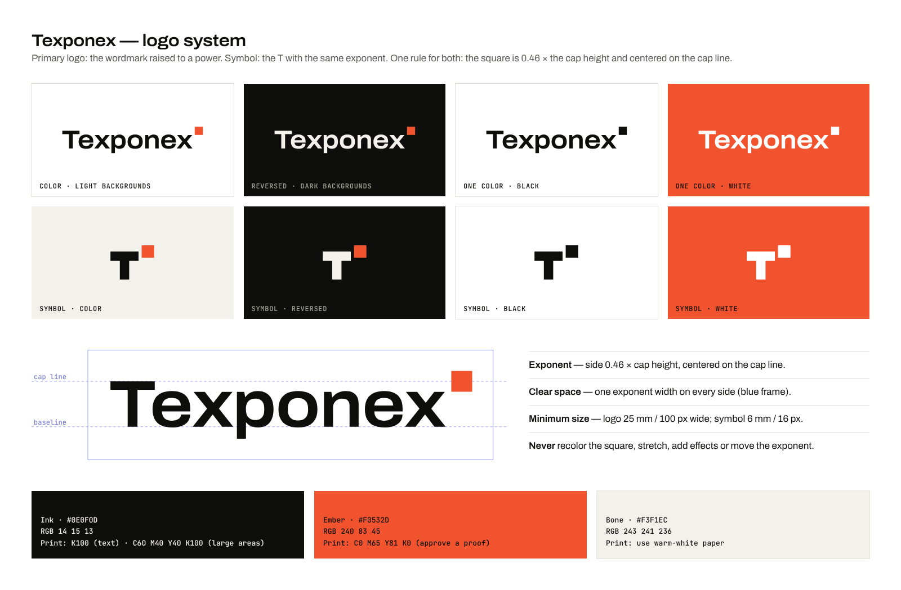
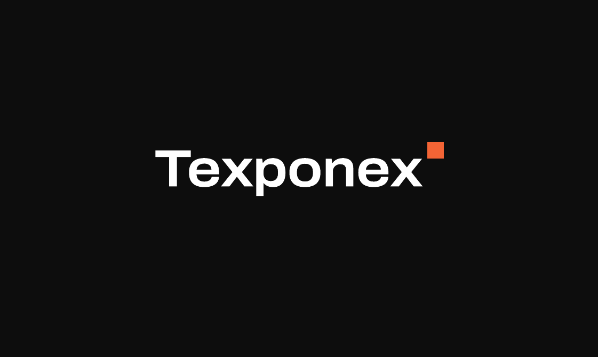
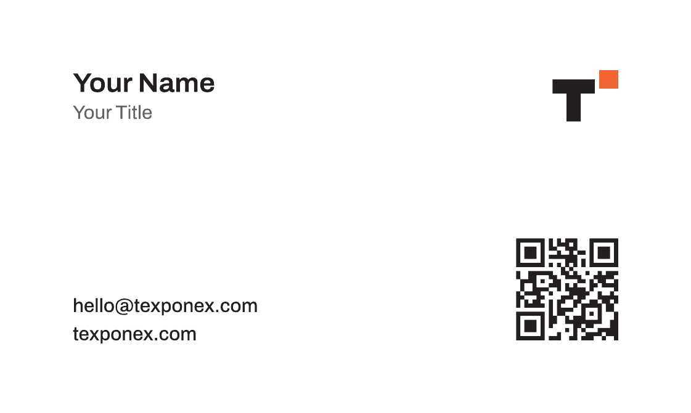
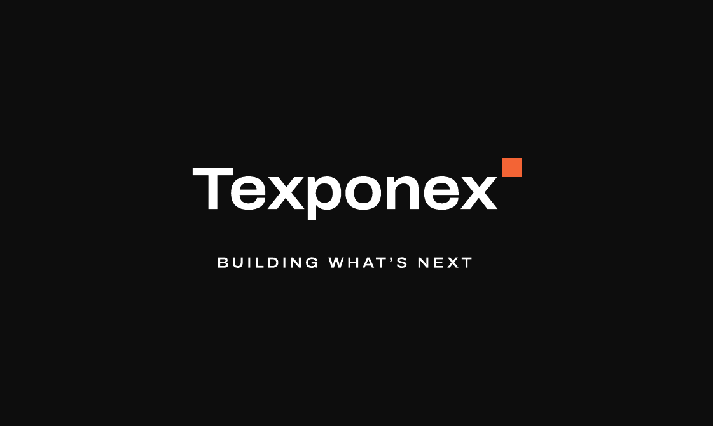
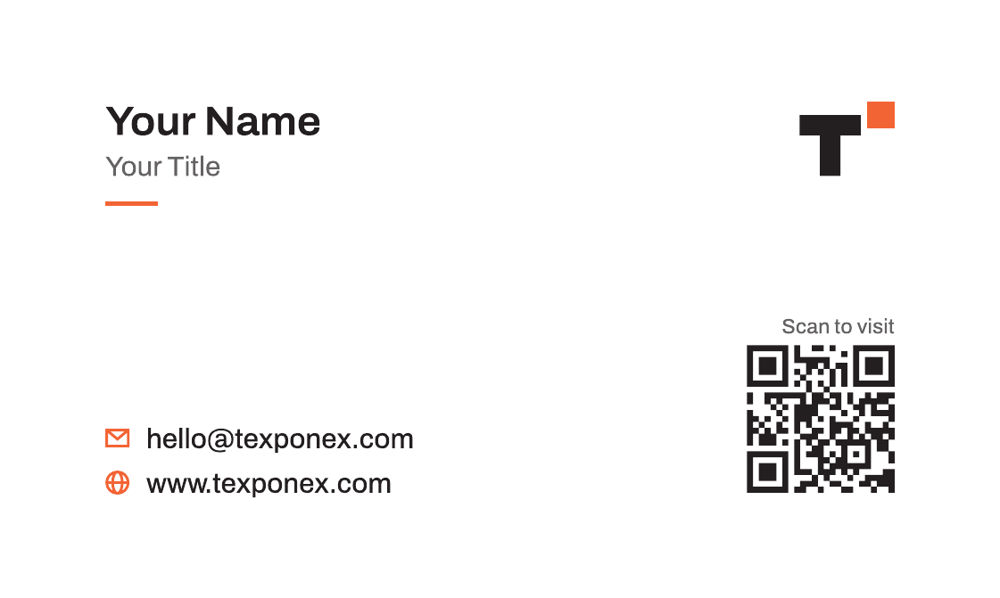

# Texponex — Brand kit

Everything needed to use the Texponex logo correctly on screen and in print.
All files are generated from one source (`scripts/brand/brand.py`), so every
version is exactly the same logo.



## The logo

**Primary logo — the wordmark raised to a power.** “Texponex” set in Archivo, with
an ember square placed like a mathematical exponent: *building what’s next.*

**Symbol — the T with the same exponent.** For small, square spaces: favicon, app
icon, social profile pictures, a stamp on the back of a card.

One rule ties them together: **the square is 0.46 × the cap height and centered on
the cap line.** It is the brand’s signature device; the same small ember square
appears throughout the website.

## Which file do I use?

| I need… | Use |
| --- | --- |
| **Printing** (business cards, letterheads, signage, merchandise) | `logo/pdf/*-cmyk.pdf` — vector, CMYK, scales to any size |
| Designers / print shops asking for “vector” or “AI/EPS/PDF” | `logo/pdf/*-cmyk.pdf` (or `logo/svg/*.svg` for screen work) |
| Websites, presentations, documents | `logo/svg/*.svg`, or `logo/png/*` if SVG isn’t accepted |
| Word / PowerPoint / Google Docs | `logo/png/texponex-logo-color-1200w.png` (light slides) or `-reversed-` (dark slides) |
| Social media profile picture (LinkedIn, WhatsApp, X, Instagram) | `social/texponex-avatar-dark-1080.png` (or `-light-`) |
| Email signature | `logo/png/texponex-logo-color-1200w.png`, displayed ~160 px wide |
| Favicon / app icon | Already on the website (`src/public/`) |

### Colorways

| File name part | Looks like | Use on |
| --- | --- | --- |
| `color` | Ink wordmark + ember square | White or light backgrounds — **the default** |
| `reversed` | Light wordmark + ember square | Black or dark backgrounds (the light parts are white/unprinted, so this file looks almost empty on a white screen — that is correct) |
| `black` | All black | One-color printing: stamps, engraving, receipts, fax, newspaper |
| `white` | All white | One-color on color: on ember, on photos, on dark single-color print |

PNG files have transparent backgrounds and include the required clear space.

## Rules

- **Clear space:** keep one exponent width free on every side (built into every file).
- **Minimum size:** primary logo **25 mm** wide in print / **100 px** on screen;
  symbol **6 mm** / **16 px**.
- **Don’t:** recolor the square or the wordmark, stretch or skew, add shadows, glows or
  outlines, move or resize the exponent, retype the name in another font, or place the
  color logo on a busy photo (use the white version on a dark overlay instead).

## Colors

| Name | Screen (HEX / RGB) | Print (CMYK) | Notes |
| --- | --- | --- | --- |
| **Ink** | `#0E0F0D` · 14 15 13 | **K100** for the logo and text; **C60 M40 Y40 K100** (rich black) for large solid areas | Never use rich black for small text |
| **Ember** | `#F0532D` · 240 83 45 | **C0 M65 Y81 K0** | Calculated, then built without black for a clean result. **Approve a printed proof.** For spot-color printing, ask the printer to match against a physical Pantone guide — candidates to compare: *Pantone 172 C* and *Warm Red C* |
| **Bone** | `#F3F1EC` · 243 241 236 | — | In print, choose a warm-white paper rather than printing this tint |

Screen and print colors never match exactly; the printed proof is the reference.

## Typography

- **Archivo** (SIL Open Font License) — headings at width 108–112 %, body at 100 %.
- **JetBrains Mono** — small labels only.
- Font files: `src/assets/fonts/` (subset for the web). For desktop use, download the
  full families free from Google Fonts.

## Business cards

Print-ready file: [`print/texponex-business-card.pdf`](print/texponex-business-card.pdf)
(page 1 front, page 2 back).

| Front | Back |
| --- | --- |
|  |  |

Version B, same size and colors, adds the tagline on the front, line icons beside the
contact details and a “Scan to visit” label above the QR code:
[`print/texponex-business-card-b.pdf`](print/texponex-business-card-b.pdf)

| Front (B) | Back (B) |
| --- | --- |
|  |  |

**Specification**

| | |
| --- | --- |
| Finished size | 3.5 × 2 in (88.9 × 50.8 mm) — standard in India and the US |
| Bleed | 3 mm on every side (file size 94.9 × 56.8 mm) |
| Safe area | Text and logo at least 5 mm inside the trim edge |
| Color | CMYK; front background rich black C60 M40 Y40 K100; ember C0 M65 Y81 K0 |
| Text | Converted to outlines — no fonts needed by the printer |
| QR code | Back, bottom-right, 14 mm, black (K100) only, links to `https://texponex.com`; quiet zone kept clear; verified to decode from the print file |
| Boxes | PDF TrimBox and BleedBox are set; no crop marks (most printers prefer this) |

**Put your details on the card — privately**

This repository is public, so personal details are kept out of it:

1. Create `brand/business-card.local.json` (git ignores it) with your details, e.g.

   ```json
   { "name": "Your Name", "title": "Your Title", "phone": "+91 00000 00000" }
   ```

   Any field you leave out (email, website, QR link) comes from
   [`business-card.json`](business-card.json), which holds the public company details.
2. Run `npm run brand` (needs `pip install fonttools brotli uharfbuzz segno` once).
3. Your card is written to `brand/print/private/` (also git-ignored); the card in
   `brand/print/` keeps the placeholders **“Your Name” / “Your Title”**.

**Recommended production** (ask your printer): 350–400 gsm uncoated or matte card in a
warm white; optional soft-touch matte lamination on the front only. Ask for a printed
proof before the full run, and tell the printer the file is CMYK with 3 mm bleed and
outlined text.

## Regenerating the kit

```bash
pip install fonttools brotli uharfbuzz segno   # once
npm run brand
```

This rebuilds the website logo assets, every file in this folder, the favicon, app
icons and the social sharing image. Commit the results.
